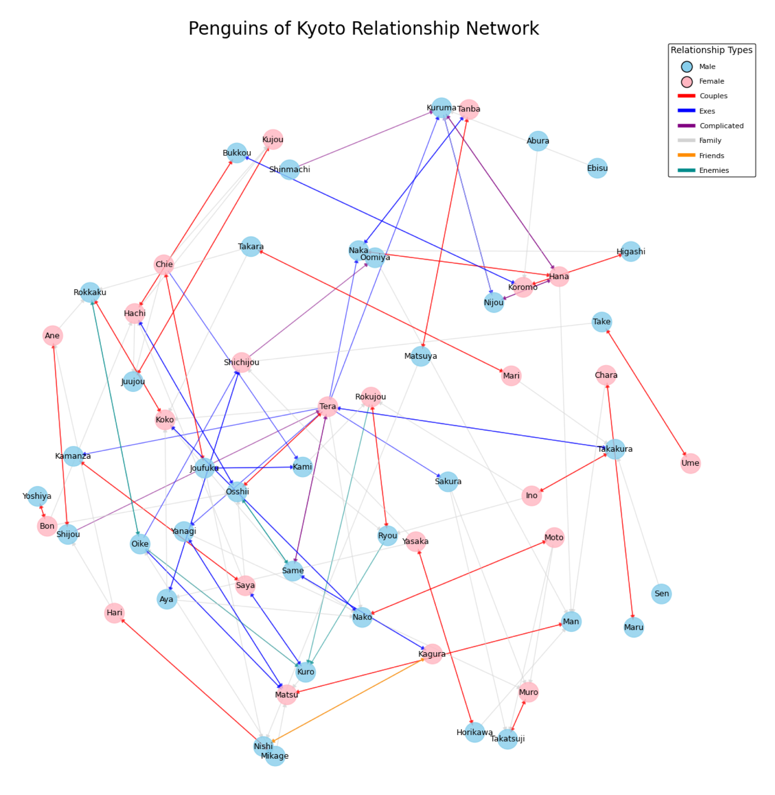
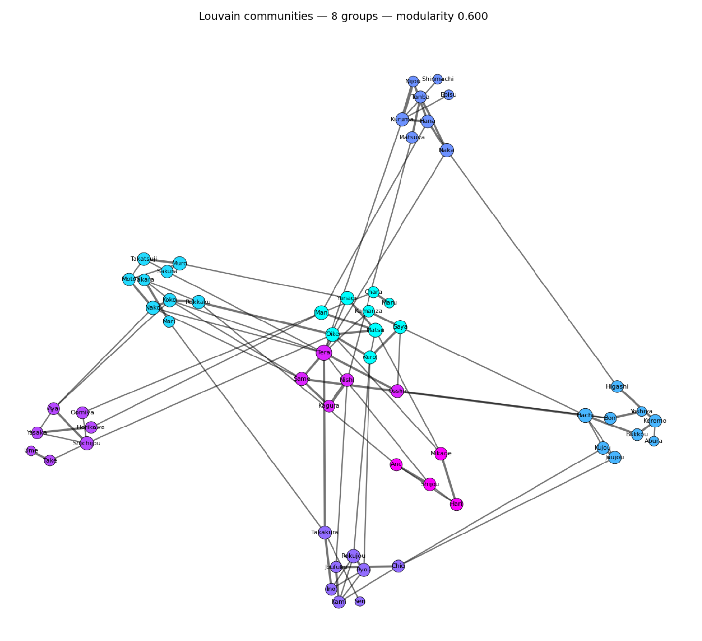

# 🐧 Penguins Social Network

Social network analysis of penguins living in the Kyoto aquarium.

---

## Report

**The colony forms one connected but sparse social network, with distinct local communities and a few particularly central individuals.** Tera stands out across several measures, while other penguins connect different parts of the network or belong to locally cohesive groups.

### Context and data

This project applies Social Network Analysis (SNA) to African penguins (*Spheniscus demersus*) at Kyoto Aquarium. It is the case study of my Master's Thesis. The goal is to explore how network measures describe animal societies and support biological, welfare and conservation interpretations.

The **2020 dataset**, encoded by **Heather Z. Brooks and Michelle Feng** from the aquarium's relationship chart, contains **59 named penguins** and six relationship categories: Couples, Exes, Complicated, Friends, Enemies and Family. These include current and former partnerships, ambiguous romantic relationships, friendship, antagonism and kinship. See the [dataset documentation and citation](data/README.md).



*Thesis Figure 5.1. Blue and pink nodes identify males and females; edge colors distinguish the six relationship categories. Positions show network structure, not locations in the aquarium.*

### How the analysis works

The [Python notebook](analysis.ipynb) combines six GEXF relationship layers into a directed multigraph with **139 edges**, retaining relationship categories and allowing multiple relations between the same individuals. Preprocessing removes extra spaces from names, joins CSV metadata and checks the availability of sex attributes. NetworkX computes network measures; Matplotlib visualizes the results.

Most analyses use undirected representations because the source does not consistently define the meaning of edge direction. Density, triangles and cores describe an aggregated topology; centrality calculations use the representations appropriate to each measure. For weighted community analysis, contributions from original edges are accumulated between each pair. Such weights summarize encoded relations, rather than measured interaction frequency or duration. Directed measures remain exploratory.

### Network structure and communities

| Measure | Result reported in the thesis | Reading |
| --- | --- | --- |
| Connected components, undirected network | 1 | All individuals belong to one connected structure |
| Density, simple undirected network | 0.0578 | About 6% of possible pairwise links are present |
| Average shortest path | 3.75 | Individuals are separated by fewer than four links on average |
| Diameter | 9 | The longest shortest path spans nine links |
| Triangles / global transitivity | 22 / 0.2171 | Some associations close into small groups |
| Maximum k-core | 3 | The deepest core retains at least three neighbors per member |
| Louvain communities / modularity | 8 / approximately 0.6 | Recognizable internal groups |

The **139 original directed edges** and density refer to different representations: density collapses parallel and reciprocal relations into undirected pairwise links.

Low density does not imply disconnected groups. The colony remains globally connected while associations concentrate in smaller circles. The thesis reports 18 maximal cliques of size three and one of size four: tightly connected groups are small. Communities are larger structural groupings, whose members need not all be directly linked.



*Thesis Figure 5.10. Colors identify eight Louvain communities; links between colors show their integration into the same network. The layout emphasizes community structure and has no spatial meaning.*

### Which penguins are central?

Centrality captures several aspects of an individual's position. The thesis identifies complementary roles:

| Measure | What it describes | Main findings |
| --- | --- | --- |
| Degree | Number of incident links | Tera: 11, versus a network mean of 3.36; Kuruma, Hachi and Koko: 6 |
| Closeness | Shortest-path proximity to the rest of the network | Tera: 0.4085; Same and Koko: 0.3452 |
| Betweenness | Presence on shortest paths between other individuals | Tera: 0.4117; Naka, Osshii, Man and Kuro also stand out |
| Eigenvector | Connection to other central individuals | Tera: 0.4869; followed by Koko, Same and Nako |
| Load | Potential shortest-path traffic through a node | Tera: 0.4017; Naka, Man, Kuro and Osshii also rank highly |

Tera is both highly connected and strategically placed. Other individuals have more specific bridging roles or connections to central neighbors. Females such as Tera, Koko and Hachi are prominent, alongside several males; these findings do not establish a generally female-centered social structure.

### Relationship categories reveal different patterns

Reciprocity measures the fraction of directed links with a reverse link. Sex homophily here means the share of linked pairs whose members have the same sex.

| Relationship | Reciprocity | Same-sex share |
| --- | --- | --- |
| Couples | 1.000 | 0.00 |
| Exes | 0.774 | 0.10 |
| Complicated | 0.667 | 0.17 |
| Friends | 1.000 | 0.00 |
| Enemies | 0.571 | 0.80 |
| Family | 0.000 | 0.50 |

Partnerships and friendships are reciprocally encoded, whereas antagonistic relations are more asymmetric and mostly connect individuals of the same sex. **Friends represents just one pair**, so its values cannot establish a general friendship pattern. Family's zero reciprocity likely reflects directional encoding of kinship. These descriptive proportions do not establish statistically tested preferences.

### Interpretation, limits and next steps

The comparison with animal-network literature supports a picture of **global integration, local differentiation and selective structural centrality**. It also shows why affiliative, antagonistic and family relations need separate interpretation. Low density alone is insufficient to diagnose weak cohesion, and comparisons across species require attention to network size and data collection.

These results describe a **static, categorical snapshot of one captive colony**. The data lack interaction frequency, duration, biological outcomes and repeated observations. Centrality identifies potential bridges but cannot demonstrate actual information or pathogen transmission, dominance, stress or impaired welfare. Effects of removing central individuals and claims about resilience also require further analysis. Findings cannot be generalized directly to wild populations.

Future work could add biological and welfare data, compare successive aquarium charts, analyze affiliative and antagonistic layers separately, assess patterns with permutation tests or null models, and simulate targeted versus random node removal. Behavioral and longitudinal observations would be needed to connect structural findings to welfare and management outcomes.

*Source: thesis Chapters 5–6 for results and interpretations, Chapter 7 for future work. Values and figures summarize the thesis rather than a new analysis. Explore the [analysis notebook](analysis.ipynb) for the implementation.*

---

## ⚙️ Setup

### 1. Create and activate the Conda environment
```bash
conda create -n socialNetwork python=3.10 -y
conda activate socialNetwork
```

### 2. Install the dependencies
```bash
pip install -r requirements.txt
```

### 3. (For VSCode) Add the environment as a Jupyter kernel
```bash
python -m ipykernel install --user --name socialNetwork
```


